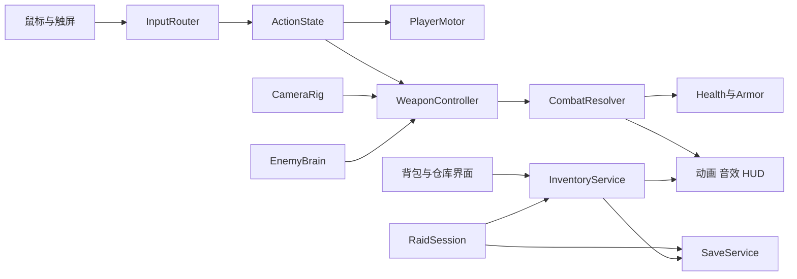
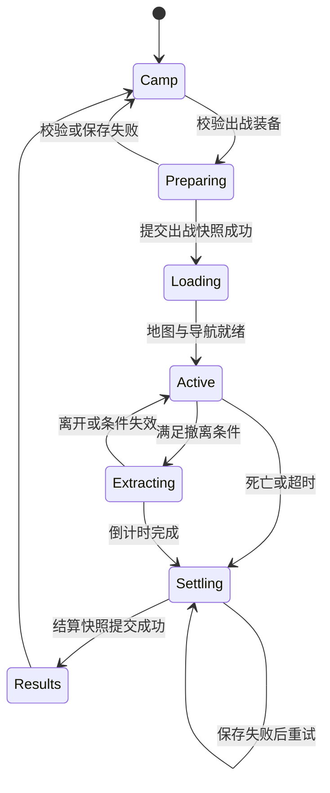

# 余烬行动后续开发技术设计

版本 1.3 · 2026年11月6日 · 状态：第三阶段搜索、库存、仓库与恢复存档首轮实现完成，后续设计继续有效

本文规定后续开发的模块职责、接口、状态、数据和验收条件。目标是在现有 Godot 项目上逐步完成可持续游玩的单人离线搜打撤游戏，保留第一第三人称和面向 iPad 的横屏触控。玩法目标见[游戏设计与开发规划](../../planning/余烬行动游戏设计与开发规划.html)。

**优先顺序：输入与命中可靠 → AI战斗可靠 → 搜索与仓库闭环 → 单图内容 → 美术替换与设备优化。** 当前原型继续作为迁移基线，逐个系统替换，不一次性重写整个游戏。

开发阶段用 M0 至 M5 表示。当前构建 `phase3-20261106` 在操作、枪械和守卫基础上完成 M2A/M2B 首轮可玩实现：物品定义、格子库存、固定逐件搜索、配装仓库、实物结算与可靠本地恢复。实现和取舍见[第三阶段报告](PHASE3_REPORT.md)，历史见[第二阶段报告](PHASE2_REPORT.md)和[第一阶段报告](PHASE1_REPORT.md)。这不代表后续内容、正式美术或 iPad 验收完成。除明确标记为已实现的内容外，本文的目录、类型、接口、参数和验收仍为后续约定。

## 1 范围与基础决策

- 引擎锁定现有 **Godot 4.7.2 标准版和 GDScript**。首轮沿用 Compatibility 渲染，升级引擎或切换渲染器需要单独回归。
- Windows 是当前开发和试玩平台；iPad 是目标设备，具体型号、iPadOS版本及最终交付方式待确定。不得把桌面测试通过标记为移动端验收通过。
- 单机本地权威：只有本地游戏逻辑改变生命、物品、货币和任务进度。首版不设计服务器、联网账号、联机同步或反作弊。
- 美术资源采用原创或许可明确的资产；不使用原游戏提取素材。资产清单必须记录来源、许可、单位、贴图尺寸和导入参数。
- 舒适模式允许暂停和较轻损失；标准模式保留完整损失规则。规则是数据配置，不应散落为代码分支。
- 全项目以米、秒、弧度为基础单位；引擎空间约定 Y 向上、角色局部 -Z 向前。UI显示角度时转换为度。

## 2 当前基线与优先风险

### 2.1 迁移前基线

迁移前入口为 `main.tscn`，挂载约725行的 `game.gd`，同时生成地图、人物、枪械、UI和音效，并负责输入、AI、射击、背包、结算与存档。该版本源码保存在 `../../planning/baselines/pre_m0/`；以下风险依据与行号针对这份基线，不是当前文件行号。

| 当前实现 | 迁移目标 | 主要原因 |
| --- | --- | --- |
| `_unhandled_input` 与大量全局变量 | InputRouter 与 InputFrame | 统一多指归属、暂停释放与灵敏度 |
| `_physics_process` 中移动和相机代码 | PlayerMotor 与 CameraRig | 独立验证碰撞、视角和姿态 |
| `_fire` 与 `_visible` | CombatResolver 与 PerceptionSystem | 双方共享遮挡与命中规则 |
| `bag` 和容器 Dictionary | InventoryService 与 ItemInstance | 增加占格、堆叠、唯一身份与事务 |
| `_finish` 与 `_save` | RaidSession 与 SaveService | 防止重复结算并支持实物仓库 |
| 程序化几何和节点动画 | 独立场景与表现组件 | 替换模型不改战斗规则 |

审读基线：`game.gd` SHA256 为 `89764d879d41a55a57493bba1fdfa8606d30aed2cd0c591f142164b9c6ab5831`。本文行号仅用于定位该版本。

### 2.2 基线问题与迁移目标

| 编号 | 现状依据 | 技术处理与验证 |
| --- | --- | --- |
| R01 | 561至589行使用缩放后的 `relative`，俯仰限制约为向下37°、向上29° | 输入改用未缩放观察增量；俯仰可配置。验证不同分辨率和鼠标捕获状态 |
| R02 | 694至699行把距目标1.2米内的遮挡点也视为可见 | 高风险逻辑，可能导致贴掩体扣血；必须用首个命中对象判定，并添加薄墙回归场景 |
| R03 | 701至713行射线从角色附近近似位置出发，而非模型枪口 | 统一 AimSolution 与 Muzzle；检查近墙、肩后相机和小目标的视差 |
| R04 | AI距离触发追击，攻击直接扣生命；671至683行 | 实现感知、导航、瞄准延迟和共享射击流程；不能继续使用无误差直接扣血 |
| R05 | 440至455行搜索只检查距离；591至592行搜索使整段逻辑停止 | 增加遮挡与目标校验，搜索暂停改为显式规则 |
| R06 | 界面使用固定坐标；关闭触摸模拟鼠标后普通按钮行为未真机确认 | 高优先待复现：按钮、移动、观察、开火多指输入及4:3布局 |
| R07 | 633至638行缩放模型蹲下，起身没有空间检查 | 独立碰撞形状与骨骼姿势，站起前执行空间查询 |
| R08 | 存档只有财富与成功次数；524至538行 | 引入有版本的完整物品和对局快照，迁移旧存档 |

风险来自基线静态审读；“可能”或“待复现”项必须用测试场景确认。原有三个测试只覆盖局部流程，第一阶段已扩展输入、物理与完整流程回归。

### 2.3 第一阶段交付记录（历史）

- **M0A 基础完成**：保留旧入口和可恢复源码，增加构建标识及测试隔离。`test_mode` 禁止读取和写入个人存档；未迁移 `progress` 或改变存档格式。
- **M0B 基础完成**：建立 `InputRouter`、`PlayerMotor`、`CameraRig`、`ActionState`，处理输入快照、失焦/暂停/搜索取消、独立多指、连续水平观察、正负80°俯仰、相机碰撞和站起净空。输入快照目前为 Dictionary；完整配置资源和动作动画仍待迁移。
- **提前修正部分射击问题**：`AimResolver` 使用当前视角的实际 Muzzle，检查持枪点到枪口及枪口重叠；受阻不扣弹。AI 视线要求首个命中对象为玩家，取消近墙距离容差。第一阶段当时尚未实现共享 CombatResolver、命中区、护甲、导航 AI 或瞄准模式；第二阶段进展见下节。
- **试玩与回归**：新增独立靶场和灵敏度设置；模拟触屏验证三指协同。保留搜索时暂停世界及原有搜打撤流程，连续三轮搜索与撤离通过。锚点布局已接入，iPad 真机与安全区验收尚未完成。

### 2.4 第二阶段实施状态

- **M1A 首轮完成**：`WeaponController` 统一玩家与 AI 的弹匣、备弹、射速、装填与开火结果；`CombatResolver` 用最近命中射线处理头部、躯干和四肢；`HealthState` 唯一持有生命、头盔和背心耐久。`game.gd` 的旧兼容属性直接转发到这些状态，不再独立扣弹或按距离扣血。
- **规则数据化**：`WeaponDefinition` / `ArmorDefinition` 及 `data/weapons/*.tres`、`data/armor/*.tres` 提供倍率、距离衰减、穿透系数、简化防护、装填和散布参数。仍是单把步枪与当前装备配置，不含完整物品弹药档位、配件、耐久维修或库存交易。
- **动作与表现**：右键按住或 X / 触屏按钮切换瞄准；瞄准收窄视野和散布，移动与空中增大散布，空中不进入瞄准。快跑转射击保留举枪间隔；治疗持续 2.2 秒，完成才扣药回血，开火取消并保留药包。命中显示实际生命/护甲损失，敌人枪声使用有数量上限的空间音源。
- **M1B 首轮完成**：`PerceptionSystem` 做视距、视锥、遮挡和累计确认；`EnemyBrain` 实现 Patrol / Investigate / Alert / Engage / Search / Return / Dead，接收采样可见信息及一次性声音/受击位置。丢失视线后按记忆点调查和搜索，之后返岗；开火仍经过共享 WeaponController / CombatResolver。
- **导航与试玩**：`NavigationWorld` 为当前单层矩形地图生成静态可走多边形，按角色半径扩张墙体禁行区，待导航同步后通过 `NavigationAgent3D` 绕障。新增不结算奖励的双守卫战斗演练，保留静态靶场和普通搜打撤；出生有短部署缓冲，演练初始视线被掩体挡住。
- **保留范围**：M2 库存与可靠存档、M4 正式骨骼和美术、M5 iPad 签名与真机性能仍未完成。当前未实现动态门、多层导航、战术选掩体、小队协作或完整光学瞄具；不能把本轮基础 AI 当作完整战术系统。

## 3 目标目录与场景结构

以下路径为计划结构，按迁移阶段建立，不要求一次生成全部空文件。

```text
ember-3d/
  project.godot
  main.tscn                    # 迁移期间保留旧入口
  game.gd                      # 逐步退出逻辑所有权
  scenes/
    app/app.tscn               # 后续正式入口
    player/player.tscn
    player/camera_rig.tscn
    weapons/rifle.tscn
    enemies/guard.tscn
    loot/loot_container.tscn
    maps/freight_yard.tscn
    ui/hud.tscn
    ui/search_panel.tscn
    ui/stash_panel.tscn
  scripts/
    app/                       # 会话与场景加载
    input/                     # 设备输入和InputFrame
    player/                    # 移动与动作状态
    combat/                    # 武器、射击、防护和伤害
    inventory/                 # 格子占用和物品转移
    ai/                        # 感知、决策、导航
    raid/                      # 对局、撤离与任务
    save/                      # 快照、校验、迁移
    presentation/              # 动画、声音、特效
  data/
    items/ weapons/ armor/ loot_tables/ difficulties/ maps/
  assets/
    models/ textures/ animations/ audio/
    asset_manifest.json
  tests/
    unit/ integration/ fixtures/ scenes/
    run_all.gd
  docs/TECHNICAL_DESIGN.md
```

`Player` 建议结构：CharacterBody3D → BodyCollider、Movement、ActionState、Health、CameraRig、WeaponMount、Visual。`Visual` 内含导入角色和 AnimationTree；`WeaponMount` 有稳定的 `Muzzle`、握把、瞄具等定位点。第一人称武器与第三人称武器可以使用不同表现模型，但共享一份 WeaponRuntime，不能各自扣弹。

地图提供出生点、撤离区、容器点、导航区域、巡逻路线及必要掩体标记。逻辑通过稳定ID访问目标，存档不能依赖节点顺序或临时路径。

## 4 模块职责与依赖

| 模块 | 唯一负责的状态 | 公开能力 | 不应负责 |
| --- | --- | --- | --- |
| AppRoot | 当前场景与启动流程 | 加载营地、地图、设置 | 直接计算伤害 |
| InputRouter | 输入上下文、手指归属 | 产出InputFrame、清空输入 | 修改角色位置 |
| PlayerMotor | 速度、落地、姿态碰撞 | 移动、跳跃、站立空间检查 | 操作背包 |
| ActionState | 动作互斥和允许条件 | 判断能否开火、换弹、搜索 | 播放决定伤害的动画 |
| CameraRig | 观察角、视角模式、相机碰撞 | 提供逻辑瞄准姿态 | 扣弹或修改生命 |
| WeaponController | 当前枪、弹匣、射速、装填 | 接受开火与换弹请求 | 直接写UI和存档 |
| CombatResolver | 本次命中与伤害结果 | 遮挡查询、伤害结算 | 控制AI策略 |
| InventoryService | 物品实例、容器占用、修订号 | 校验并提交物品事务 | 根据UI拖动直接扣钱 |
| EnemyBrain | AI状态、记忆、当前目标 | 接收感知结果并产生行动 | 读取被遮挡玩家的实时位置 |
| RaidSession | 计时、目标、撤离与结算 | 开始、暂停、结束对局 | 自行序列化所有节点 |
| SaveService | 快照版本、持久化代次 | 校验、提交、加载、迁移 | 无条件信任JSON内容 |
| Presentation | 动画、特效、音频、HUD | 订阅结果、展示反馈 | 修改命中结果与物品所有权 |

只考虑两个全局服务：应用生命周期与存档服务。InventoryService、RaidSession、CombatResolver归当前会话所有，采用显式引用注入，避免所有模块都通过一个全局事件总线互相改状态。



图中指向 SaveService 表示提交完整会话快照的请求，最终仍由同一个提交队列串行处理。不得出现库存已保存、对局状态尚未保存的分裂提交。

## 5 公共接口与事件契约

以下为项目自定义接口草案，不是Godot内置API，也不是可直接运行的实现。类型随模块建立，但字段含义与责任不能随意漂移。

```gdscript
# InputRouter
func consume_frame(tick_id: int) -> InputFrame
func set_context(context: InputContext) -> void
func cancel_all(reason: StringName) -> void

# WeaponController
func request_fire(aim: AimSolution, tick_id: int) -> ShotResult
func request_reload() -> ActionResult
func cancel_reload(reason: StringName) -> void

# InventoryService
func preview_transfer(command: TransferCommand) -> TransferResult
func commit_transfer(command: TransferCommand) -> TransferResult

# RaidSession 与 SaveService
func request_extract(exit_id: StringName) -> ActionResult
func settle_raid(raid_id: String, outcome: StringName) -> CommitResult
func commit_snapshot(snapshot: Dictionary, expected_generation: int) -> CommitResult
```

关键返回值：

- `ActionResult`：`ok`、`reason`。拒绝原因统一为 `busy`、`blocked`、`no_ammo`、`invalid_target` 等稳定标识，由UI本地化。
- `TransferCommand`：`command_id`、`item_id`、`quantity`、源和目标容器ID、目标格坐标、旋转标记、预期库存修订号。
- `ShotResult`：`accepted`、`shot_id`、`origin`、`end_point`、`hit_entity_id`、`hit_zone`、实际生命与护甲损失、`blocked`。未接受开火不消耗弹药。
- `CommitResult`：是否持久化成功、新代次、错误码；成功之前UI不能显示“已保存”。

结果信号建议为 `shot_fired(result)`、`damage_applied(event)`、`inventory_changed(revision)`、`raid_finished(result)`、`save_failed(code)`。同一个 `shot_id` 对同一目标只结算一次。动画只监听结果；掉弹壳、音效和枪口火光不再反过来触发伤害。

## 6 输入和物理更新

### 6.1 InputFrame

一次物理更新读取一份输入快照：移动二维向量、累计观察增量、按住开火与快跑、开镜意图，以及跳跃、蹲下切换、换弹、交互等一次性边沿事件。一次性事件在消费后清零，禁止同一次按下在多个物理帧重复执行。

- 键盘和手柄动作统一配置到 InputMap；业务模块读取动作意图，不再硬编码具体键值。
- 鼠标使用捕获模式下的 `screen_relative`；触屏观察使用 `InputEventScreenDrag.screen_relative`，避免画面拉伸改变灵敏度。[1][2]
- 鼠标角度增量按像素乘灵敏度，不再乘帧时间；触屏可按屏幕短边比例归一化，并提供个人灵敏度。不要将累计位移再次乘 `delta`。
- 连续水平旋转；俯仰初始目标范围为正负80°，作为配置值，不是原作参数。禁止相机接近垂直时产生翻转。
- GUI控件优先认领手指；未被控件认领的触点才进入移动或观察区。手指移动过屏幕中线也不换角色，直到释放或取消。
- 多指释放、系统取消、失焦、暂停、搜索界面打开和场景切换都调用 `cancel_all`。关闭界面后要求重新按下，防止残留射击。
- 进入鼠标捕获的首次点击仅捕获，不开枪；Esc释放并清空射击。无鼠标的触屏路径不能调用鼠标捕获流程。

移动、观察、开火三指并行是必须测试的用例。第一阶段已在 `_input` 中让按钮认领触点，并在 GUI 消费事件之前处理释放；通过 `Viewport.push_input` 模拟三指验证。该结果不能替代 iPad 真机验收。

### 6.2 固定更新顺序

计划使用60Hz物理更新作为初始配置，渲染帧率独立。每个物理tick按以下顺序：

1. 消费输入并处理上下文变化。
2. ActionState检查请求合法性。
3. PlayerMotor更新姿态碰撞、水平速度与重力，执行移动。
4. 更新逻辑观察姿态、武器握持点和未插值的瞄准数据。
5. 感知与AI决策产出敌人行动请求。
6. WeaponController检查射速和装填，CombatResolver做物理查询和伤害结算。
7. RaidSession更新计时、任务与撤离状态。
8. 发布表现事件；根据明确提交点保存会话快照。

物理空间查询集中在物理更新内，不从鼠标回调或按钮回调直接查询。[3] 相机视觉平滑不能让射击读取过期插值姿态；逻辑瞄准与渲染相机分开记录。

## 7 动作状态与射击

### 7.1 分层状态

避免建立“蹲下且换弹且空中”这类组合爆炸。采用三个维度：移动状态、武器动作、UI上下文。

- 移动：Grounded、Airborne；Grounded下为站立或蹲下，并有快跑意图。
- 武器：Ready、Firing、Reloading、Healing、Equipping、Disabled。
- 上下文：Gameplay、Search、Inventory、Pause、Results。
- 开镜是受武器状态和移动状态限制的意图，最终由ActionState决定是否生效。

| 当前动作与请求 | 首版规则 |
| --- | --- |
| 快跑中按开火 | 退出快跑，等待举枪恢复，再按按住状态射击；不自动提前消耗弹药 |
| 快跑中开镜 | 退出快跑后开镜 |
| 换弹中按开火 | 不开火；首版不支持射击取消换弹，界面明确反馈 |
| 换弹中跳跃 | 允许跳跃，装填计时继续；倒地或装备切换取消装填 |
| 蹲下时跳跃 | 站立空间足够才起身跳；不足则拒绝 |
| 空中按开火 | 允许腰射并增加散布，首版不允许空中开镜 |
| 治疗中移动 | 可慢速移动；开火取消治疗，完成之前不回血 |
| 搜索与背包界面 | 清空移动和射击输入；是否暂停世界由难度规则决定 |
| 失焦或切后台 | 单人模式暂停并清空输入，提交允许恢复的检查点 |

跳跃速度、重力、快跑速度、举枪恢复、装填耗时和体力均来自配置。起身采用站立形状空间检查，不能先扩大碰撞体再尝试脱困。身体不再纵向缩放蹲下，视觉用动画，物理用明确的胶囊高度。

### 7.2 准星与枪口对齐

`AimSolution`至少包含观察原点、观察方向、目标点、实际枪口位置、最终射击方向及枪口阻挡状态。处理顺序：

1. 从逻辑相机中心发射可见性射线，取得准星目标或最大射程终点。
2. 将武器朝向目标点；第一第三人称分别更新表现模型。不能只给角色设置yaw而忽略枪械pitch。
3. 检查枪体与枪口是否处于墙内，并检查角色持枪基点到枪口之间是否有遮挡。枪口嵌入墙内或基点到枪口不可达属于无效起点，收枪或拒绝射击且不扣弹；不得把起点向前偏移到墙另一侧。
4. 从有效枪口朝目标点发射实际命中射线，只取最近命中；有效枪口与目标之间存在正常遮挡时，仍接受射击并扣弹，子弹击中最近掩体。
5. 对实际命中结果结算一次伤害，再播放火花、命中标志、声音和后坐力。

首版使用即时射线命中，不做重力弹道与穿透。曳光是短时视觉效果，不承担伤害。后续如果加入真实弹道，应替换CombatResolver实现，而不改背包或UI接口。

### 7.3 碰撞分层

第二阶段已在项目命名配置与 `scripts/collision_layers.gd` 统一以下层号和掩码；Interactable 层暂作保留，现有补给箱仍使用距离与 WorldSolid 遮挡校验。

| 层号 | 位值 | 名称 | 用途 |
| --- | --- | --- | --- |
| 1 | 1 | WorldSolid | 墙、地面和实体掩体 |
| 2 | 2 | ActorBody | 角色移动胶囊，用于移动碰撞 |
| 3 | 4 | DamageHitbox | 头、躯干等Area3D命中区 |
| 4 | 8 | Interactable | 容器、门、终端的交互区 |
| 5 | 16 | CameraBlocker | 需要阻挡肩后相机的几何体 |

射击查询WorldSolid和DamageHitbox，启用Area命中并排除自己的命中区；ActorBody不重复参与伤害。相机检查CameraBlocker；可挡相机的墙同时配置WorldSolid。交互同时验证距离、目标和WorldSolid遮挡。感知射线首个有效对象必须属于目标角色，不能靠“距目标很近”兜底。

### 7.4 伤害与弹药

武器发射后才扣一发弹药。换弹在逻辑完成点将备弹转入弹匣，取消时不转移；动画事件仅用来同步装填表现。治疗物资在开始时锁定但不销毁，治疗完成时消费并回血，取消时解除锁定；被锁定物品不可转移，避免治疗期间把药卖掉后仍回血。伤害计算由同一函数处理玩家和AI，包括命中区倍率、距离衰减、弹药档位、防护部位、耐久和生命损失。

第二阶段采用可测试的简化防护：原始伤害由基础值、命中区倍率和距离衰减相乘；护甲吸收量取当前部位耐久与“原始伤害 × 吸收率 × (1 − 穿透系数)”的较小值，吸收量同时扣对应耐久，其余扣生命。四肢不受头盔或背心防护，显示实际扣除值。当前玩家步枪基础伤害32、头部倍率2、四肢倍率0.65；守卫基础伤害12。数值权威来源是 `.tres` 配置，后续改数值同时更新验证。

## 8 物品数据与库存事务

### 8.1 静态定义与运行实例

静态配置使用自定义Godot Resource和`.tres`；运行时物品用独立记录。Resource可能被多个场景实例共享，所以射击和拾取不能直接修改共享定义中的弹药、数量或耐久。[4]

| 类型 | 关键字段 |
| --- | --- |
| ItemDefinition | 稳定id、显示名键、分类、格子宽高、单件重量、最大堆叠、价值、图标、世界模型、标签 |
| WeaponDefinition | ItemDefinition引用、射速、弹匣容量、弹药类型、散布、伤害衰减、开镜和装填参数、表现场景 |
| ArmorDefinition | 防护部位、档位、耐久上限、维修参数 |
| LootTable | 条目id、权重、数量区间、容器适用标签、必掉规则 |
| DifficultyProfile | AI反应与散布、搜索暂停、失败损失、恢复策略 |
| ItemInstance | 唯一instance_id、definition_id、数量、当前耐久、配件容器ID、武器运行状态 |
| ContainerState | 唯一container_id、类型、容量、格子放置或装备槽、修订号 |

首版避免可无限嵌套容器。只允许明确的仓库、背包、装备槽、战利品容器和地面掉落容器。配件放入`attachment_slots`类型容器，该容器记录`owner_item_id`及槽位到配件实例的映射。枪械实例只记录`attachment_container_id`，UI中的配件列表从该容器派生；配件不能同时存在于仓库和枪械槽位。

配置增加`content_version`，每份存档记录使用过的内容版本。地图布局、掉落、AI决策和声音变调分别使用独立随机源；测试使用固定种子，音效调用不得改变下一件掉落。需要恢复的随机进度保存对应流状态，或从稳定实体ID派生，不能只存一个全局seed却承诺完全重放。

### 8.2 不变量

1. 每个物品实例在一个已提交快照中只有一个所有者；容器放置表或装备与配件槽位表是所有权的唯一来源，不再在物品上存一份容易冲突的位置。
2. 堆叠数量大于0且不超过定义上限；堆叠拆分产生新ID，合并后移除空实例。
3. 每个格子只被一个物品占用，旋转后重新检查矩形边界与重叠。
4. 所有引用必须存在；未知定义ID在迁移时进入隔离记录并提示，不能静默删除值钱物品。
5. 金钱使用整数，交易不允许负数量、负余额和浮点货币误差。

### 8.3 转移与搜索

UI先请求预览，再提交TransferCommand。提交时重新校验来源、数量、目标空间、当前修订号和访问权限；旧修订号拒绝并刷新UI。成功后一次性移出来源、移入目标并递增修订号，失败则双方不变。对需要立即持久化的转移，先构造候选快照并完成写档，再发布新的权威库存与UI事件；写档失败时保留旧状态并提示重试，不允许先显示拾取成功再静默回滚。

“全部拾取”是一个确定顺序的批量事务：按槽位顺序取可容纳物品，返回已取与剩余清单。满包不是删除剩余物品的理由。通过`command_id`识别重复请求，不能仅靠禁用按钮防复制。

容器内容首次生成后固定，并记录到本局检查点。搜索揭示顺序、已揭示槽位和进度独立于物品列表，关闭重开不得重抽内容。UI不持有世界节点作为物品身份，使用稳定ID；容器节点被销毁后，服务仍可正确处理或拒绝旧请求。

## 9 对局生命周期与可靠存档

### 9.1 对局状态



Preparing时生成`raid_id`，将携带物品从仓库转入本局拥有的装备容器，并在同一快照中保存地图ID、随机种子、难度配置与状态。提交成功才加载地图。不能先删除仓库物品、后创建本局数据。

撤离条件由ExitDefinition定义，包括范围、等待时间、开启条件和可用次数。计时由RaidSession管理；重复点击不重复启动、计时完成只请求一次结算。死亡与撤离在同一tick发生时，首版规定死亡优先，所有测试使用相同规则。

### 9.2 存档结构示例

下面是一个营地快照的最小结构示例。ID和值仅用于说明，示例不包含全部未来字段。对排除`record_sha256`字段后的整个记录采用稳定序列化并计算SHA256，包含schema_version、content_version、generation和payload，校验用于识别损坏，不是防篡改或反作弊。

```json
{
  "schema_version": 1,
  "content_version": "prototype_1",
  "generation": 12,
  "payload": {
    "profile_id": "local_profile",
    "currency": 1200,
    "wins": 2,
    "items": {
      "item_001": {
        "instance_id": "item_001",
        "definition_id": "medkit_basic",
        "quantity": 2,
        "durability": null,
        "attachment_container_id": null
      }
    },
    "containers": {
      "stash_main": {
        "kind": "grid",
        "width": 8,
        "height": 10,
        "revision": 4,
        "placements": [
          {"item_id": "item_001", "x": 0, "y": 0, "rotated": false}
        ]
      }
    },
    "tasks": {},
    "active_raid": null,
    "settled_raids": {
      "raid_002": {"outcome": "extracted", "credited_value": 320, "item_count": 2}
    },
    "settings": {"difficulty_id": "exploration", "search_pauses": true}
  },
  "record_sha256": "由保存程序计算"
}
```

进行中的`active_raid`至少记录：raid_id、map_id、seed、规则快照、运行状态、剩余时间、玩家位置与朝向、生命、装备与背包容器ID、容器内容与揭示状态、任务进度、敌人存活与必要状态、撤离状态。几何、贴图和可重建的特效不存档。

### 9.3 双槽提交

所有持久化由SaveService串行执行，首版不引入异步写线程。

1. 读取当前代次，拒绝过期的`expected_generation`。
2. 在内存中构造完整候选快照，验证全部数据不变量。
3. 将新代次写入非活动槽的临时文件，flush并关闭；重新读取，校验结构与摘要。
4. 使用同目录替换完成该槽提交，保留另一槽完整；检查文件操作返回值。
5. 提交成功后才更换内存中的已提交版本并发出成功事件。

计划文件为`user://saves/profile_A.json`、`profile_B.json`及临时文件。启动只在完整正式槽中选择最高有效代次；临时文件不自动视为提交。高代次损坏则回退有效槽并告知用户，不能直接初始化新档覆盖证据。

文件替换与断电持久性受平台影响，双槽不能宣称绝对防断电；必须故障注入验证各步骤。未来若引入Web版本，需单独验证浏览器持久存储同步和缓存清理行为，不能照搬原生文件可靠性假设。读写可基于Godot FileAccess实现。[5]

### 9.4 结算幂等与恢复

`settle_raid`先查询已提交的`settled_raids`账本：已存在的raid_id直接返回`already_applied`及保存的精简结算结果，不追加奖励。不存在时，才校验raid_id是否匹配当前active_raid及其状态。成功结算时，物资转仓库、货币和任务变化、结算账本记录以及active_raid清空必须属于同一次快照提交。错误raid_id或旧修订请求一律拒绝。

首版采用检查点恢复：生成本局物资后、库存转移、任务变化、装备变化、退出到营地等重要事件提交快照；运行中按可配置周期保存位置与计时。切后台尽力提交，但不依赖系统一定给足时间。异常关闭后从最后有效检查点恢复，最多损失最近未提交的动作；这一规则属于离线体验选择。

旧版`progress.json`作为schema 0，仅有wealth与wins。首次迁移到v1时保留这两个值，发放一次明确的基础套装并记录迁移标记；旧文件保留备份。迁移失败不覆盖原档。遇到高于程序支持的schema_version停止加载并提示，禁止擅自降级保存。

## 10 AI与地图导航

第二阶段已实现下述基本状态与共享射击流程。当前感知每 0.125 秒采样一次，连续可见累计确认 0.30 秒，之后有 0.65 秒反应准备和有限转向速度；守卫按短连发与间隔节奏射击。玩家枪声通过 `hear(position,strength)` 发送当时位置，尚未建立完整 NoiseEvent 类型或墙体声传播。静态导航使用 1 米网格生成多边形和 0.60 米墙体净空，适合当前单层矩形场景，不等同于任意地图自动烘焙。

EnemyBrain只接收PerceptionSystem给出的已知信息。感知包括可见目标、听到的声音位置、最后发现时间和可疑程度；目标丢失后记忆停留在最后位置，而不是追随隐藏玩家坐标。

首版状态为Patrol、Investigate、Alert、Engage、Search、Return、Dead。每个状态至少规定入口动作、结束条件和超时回退，避免AI卡在门后无限追击。

- 视觉先筛距离与视锥，再检查遮挡，并累计确认时间；不能发现身后目标后瞬间转身精准开枪。
- 听觉来自世界中的NoiseEvent，含来源位置、强度、类型和时间。先用简单距离衰减，再考虑门墙传播。
- 敌人使用NavigationAgent3D查询路线，由角色移动代码执行移动；导航节点不会自动推动角色。[6]
- 路径需在导航地图同步后请求；寻路、目标选择和移动更新分开限频。首版感知可试5至10Hz，移动仍每物理tick执行，此频率需实测调整。
- 射击前有反应时间、转向速度、散布和可见性条件，并经过同一个WeaponController与CombatResolver。
- 地图中的掩体点仅作候选；使用前验证可达性、朝向和是否仍受攻击。没有有效掩体时允许撤退或停火，不能穿墙移动。

基础地图先采用静态导航网格；动态门和障碍需定义重新寻路策略。避障不能替代完整寻路，也不能作为命中遮挡。Boss和AI小队协同后置，先保证一种敌人公平可读。

## 11 动画音效与美术接入

角色导入以米为单位，统一朝向、根节点、骨架命名和动画片段。导入模型包在独立Visual场景中；不能让资源更名破坏PlayerMotor或库存数据。根运动首版不驱动角色位移，位移由PlayerMotor掌管，动画根据实际速度混合。

AnimationPlayer提供片段，AnimationTree负责走跑、蹲行和上半身动作混合。[7] 枪械模型提供Muzzle、Aim、GripRight、GripLeft、Magazine、Eject等定位点；第一人称与第三人称共用逻辑装备ID，但分别配置模型和动画。

换弹开始、弹匣操作、枪机动作和装填完成分离。暂停、掉帧或动画中断不能改变实际弹药结算时刻。后坐力分别配置相机偏转、枪械位移、回正速度和连续射击增量，不能通过不断累加pitch而缺少回正规则。

枪声和脚步使用空间音源；HUD命中提示可用非空间音源。建立声效并发上限，预加载短音效，对脚步、枪声、环境声分组调节。枪口闪光、弹壳、命中特效和曳光采用有生命周期的池，不能无限创建节点且依赖场景退出清理。

先完成“一把枪、一名角色、一处室内外场景”的表现样板。样板通过视角、动作和设备性能测试后再复制到其他内容，避免过早积累大量不兼容资产。

## 12 UI与移动端适配

第一阶段已将主要 HUD、按钮、搜索界面和菜单改为锚点布局，并提供灵敏度滑条及触屏可点的 ± 按钮。下面的安全区、布局编辑、滚动库存等仍为后续目标。

布局使用锚点、容器和安全区，不把所有按钮固定在1280×720坐标。至少检查4:3、16:10与16:9横屏。搜索与仓库使用滚动容器，支持长名称、满背包、图标缺失和低分辨率。

触摸布局保存归一化位置和缩放，支持恢复默认。动作按钮触摸区域与显示图形分离，移动、观察、开火不可相互覆盖。按下和抬起的处理必须配对，触点离开按钮也能正确结束按住动作。

对话框与搜索菜单打开时显式切换InputContext；标准模式搜索不暂停世界，但HUD仍需显示受击并允许关闭。点击一件物品只产生一个请求，网络延迟概念不适用于本地，但重复点击和同帧重入仍需防护。

陀螺仪、手柄、左右手布局和无障碍细项作为扩展；初版先保证三指协同和灵敏度一致。视角晃动、镜头抖动、音量和第三人称距离需可调。

## 13 测试体系与完成标准

### 13.1 可重复测试

原有 `smoke.gd`、`test_hit.gd`、`test_movement.gd` 保留为兼容入口，分别调用 `tests/test_game.gd` 的搜索、命中、移动测试套件。现有 `tests/test_input_router.gd` 与 `tests/test_foundation.gd` 继续保留；第二阶段加入 `tests/test_combat.gd`、`tests/test_ai.gd`、`tests/test_actions.gd`、`tests/test_phase2.gd`，由 `tests/run_all.gd` 聚合执行全部七个套件，失败返回非零退出码。纯数据测试不依赖场景；涉及射线和碰撞的集成测试在物理更新调度器中执行。

从当前工作目录使用现有引擎执行：

```powershell
& 'F:\Godot-4.7.2\Godot_v4.7.2-stable_win64_console.exe' --headless --path 'C:\Users\horac\Documents\ChatGPT\好玩的\ember-3d' --script res://tests/run_all.gd
```

第一阶段场景测试设置 `test_mode=true`，跳过个人存档读取和写入；不迁移或覆盖已有 `progress`。独立 profile 和可注入保存根目录仍属于后续 SaveService 设计。当前已执行项目与复现步骤见[第二阶段报告](PHASE2_REPORT.md)，第一阶段记录保留；最终检查数量以聚合测试输出为准。

| 测试ID | 验证目标 | 通过条件 |
| --- | --- | --- |
| IN01 | 不同窗口比例的观察 | 相同归一化输入符合设置的角度变化；无拉伸导致的额外变化 |
| IN02 | 三指与取消 | 移动观察射击同时工作；暂停、失焦、触点取消后全部释放 |
| MV01 | 蹲下起身与跳落 | 低顶不能站起，跳跃不连续刷起跳，落地不穿地 |
| CB01 | 相机枪口与掩体 | 两种视角、5/15/40米靶位、贴墙和墙角结果正确 |
| CB02 | AI近掩体视线 | 目标距墙小于1.2米时仍被墙挡住，不产生隔墙扣血 |
| CB03 | 状态和弹药 | 快跑、换弹、取消、空弹和连续点击不重复消费或凭空补弹 |
| IV01 | 占格与堆叠 | 越界、重叠、旧修订拒绝；成功数量守恒 |
| IV02 | 重复拾取 | 同command_id重试不复制；满包保留剩余物品 |
| SV01 | 写入中断 | 各提交步骤注入失败后能读取某个完整有效代次 |
| SV02 | 重复结算 | 同raid_id重复结束只奖励一次，物品所有权不重复 |
| SV03 | 迁移和损坏 | schema 0只迁移一次；损坏高代次可回退；未知新版本不覆盖 |
| AI01 | 感知和绕障 | 视线丢失后不跟踪实时位置，能绕静态墙到最后发现地点 |
| RD01 | 完整流程 | 配装、入场、搜刮、撤离或失败、返回营地连续3局一致 |
| PF01 | 目标iPad长测 | 指定设备持续20分钟，无崩溃、持续输入异常和明显内存累积 |

### 13.2 性能与观测

先建立测试场景和记录格式，再确定资产上限。候选档位为30帧和60帧，对应33.3ms和16.7ms帧时间；记录CPU/GPU耗时、帧时间分布、内存、节点与绘制数量、存档耗时和温升表现。它们是目标，不是当前已达到的指标。

比较性能必须固定设备、版本、地图、种子、敌人数和路线。以热身后的20分钟流程检查持续表现，不能只看菜单或最轻场景的平均FPS。对低频AI任务做分帧调度，缓存配置与材质；只有测到瓶颈后再做对象池、批量绘制或线程化。

日志至少包含build_id、raid_id、tick_id、command_id、shot_id、save_generation和错误码；使用可关闭的环形缓冲。物品定义和运行计数可记录，完整存档只在主动导出诊断包时附带。

## 14 迁移工作包与开发顺序

| 工作包 | 内容 | 前置条件 | 合并验收 | 回退策略 |
| --- | --- | --- | --- | --- |
| M0A | 基线备份、测试隔离、配置与ID约定 | 无 | 旧场景和三个现有测试仍可运行 | 保留旧入口与原档 |
| M0B | InputRouter、PlayerMotor、CameraRig和ActionState | M0A | IN01、IN02、MV01；能完成旧场景一局 | 切回旧入口，不改存档 |
| M1A | 真实枪口、命中区、共享CombatResolver | M0B | CB01、CB02、CB03 | 保留原武器场景，不迁移库存 |
| M1B | 单种AI感知、导航、攻击 | M1A | AI01并完整试玩；无直接扣血捷径 | 替换回旧敌人场景 |
| M2A | ItemDefinition、实例、格子库存与容器 | M0A与M1A | IV01、IV02；界面只调用事务接口 | 新profile先试，不动旧档 |
| M2B | SaveService、配装、仓库、结算与恢复 | M2A | SV01至SV03、RD01 | 保留schema 0备份与上一稳定构建 |
| M3 | 原创单图、两类出口、任务与规则预设 | M1B与M2B | 三局收益/损失可核对，路径和撤离选择有效 | 地图资源独立版本 |
| M4 | 骨骼人物、完整枪械样板、空间音效 | M1A起可先做样板，全面替换依赖M3 | 视觉与逻辑一致且无明显性能回退 | 表现场景可替换回低模 |
| M5 | iPad触屏、存储生命周期、性能与交付 | 最早可部署时开始抽测，最终依赖M3/M4 | IN02、PF01及断网与读档测试 | 保留稳定安装包和存档迁移备份 |

当前已完成 M0A/M0B、M1A/M1B 与 M2A/M2B 的首轮可玩范围。第三阶段使用 InventoryService、ProfileService、RaidSnapshot 和 SaveService 实现库存事务、实物结算和双槽恢复。Windows 源码试玩采用工程内便携存档，正式导出采用 user://；详细取舍与验证见第三阶段报告。下一轮按 M3 推进原创单图、两类出口、任务与规则预设。动态导航、掩体策略与正式动作继续迭代，iPad 真机验收仍待执行。

每个工作包完成时更新本文件的状态，并附代码提交标识、测试结果、可复现步骤与未解决问题。拆分模块期间只能有一份权威状态，禁止新旧逻辑同时处理同一发子弹或同一次拾取。

## 15 待定决策与变更规则

以下项目可保留默认方案继续开发，最终配置需结合试玩确定：

- 目标iPad型号、操作系统和30/60帧优先档。
- 舒适模式的损失比例、搜索是否暂停和检查点间隔。
- 开镜采用按住或切换、是否需要陀螺仪及左右手布局。
- 授权资产预算、正式人物骨架和枪械视觉风格。
- iOS原生或其他交付形态。本轮不安装环境、不切换引擎。

涉及存档格式、物品ID、碰撞层、状态所有权或渲染器的修改必须更新此文档并添加回归检查；单纯调数值则记录数据版本。删除旧逻辑的条件是新模块通过同等场景回归，而不是新模块能启动。

## 16 技术参考

以下为Godot官方技术资料，访问日期为2026年11月6日。`stable`地址会随官方版本变化，具体API落地前在锁定的4.7.2中核对；本文接口草案均为项目自定义契约。

1. [InputEventScreenDrag](https://docs.godotengine.org/en/stable/classes/class_inputeventscreendrag.html) — 触摸观察增量与内容缩放。
2. [InputEventMouseMotion](https://docs.godotengine.org/en/stable/classes/class_inputeventmousemotion.html) — 捕获鼠标观察增量。
3. [Ray casting](https://docs.godotengine.org/en/stable/tutorials/physics/ray-casting.html) — 物理查询时机与命中结果。
4. [Resources](https://docs.godotengine.org/en/stable/tutorials/scripting/resources.html) — 数据资源和共享加载行为。
5. [Runtime file loading and saving](https://docs.godotengine.org/en/4.7/tutorials/io/runtime_file_loading_and_saving.html) — 本地文件读写基础；双槽和事务协议为本项目设计。
6. [Using NavigationAgents](https://docs.godotengine.org/en/stable/tutorials/navigation/navigation_using_navigationagents.html) — 寻路、路径跟随与角色移动责任。
7. [Using AnimationTree](https://docs.godotengine.org/en/stable/tutorials/animation/animation_tree.html) — 动画混合与角色表现。

当前实施明细、试玩方式和已知限制见[第二阶段报告](PHASE2_REPORT.md)；第一阶段源码保留在 `planning/baselines/pre_m1`，更早基线保留在 `planning/baselines/pre_m0`，个人存档未做格式迁移。
